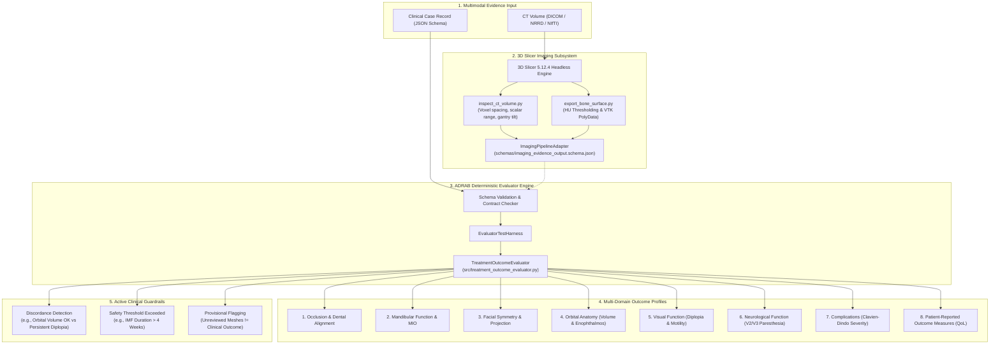

# SADIE: AI-Driven Craniomaxillofacial Trauma Treatment-Outcome Evaluator
### Evidence-Grounded, Rule-Based Multimodal Assessment Framework for Craniomaxillofacial Surgery

[](https://www.python.org/)
[](https://www.slicer.org/)
[](tests/)
[](schemas/)
[](LICENSE)

---

## 🌟 Overview

**ADRAB** is a prototype software framework designed for standardized, auditable, and multi-domain evaluation of post-operative outcomes in **craniomaxillofacial (CMF) trauma surgery**. 

CMF trauma management spans complex anatomical zones (orbit, zygoma, mandible, midface, condyle) where single-metric success scores fail to capture clinical reality. ADRAB establishes:
1. **Evidence-Grounded Clinical Rubric:** Synthesized from standard surgical reference atlases and clinical trials.
2. **Deterministic Multi-Domain Evaluation Engine:** Evaluates 8 independent clinical outcome domains without black-box scores.
3. **Rigorous Clinical Discordance & Safety Detection:** Automatically flags discordances (e.g. perfect anatomical orbital volume restoration occurring alongside functional diplopia).
4. **3D Slicer Medical Imaging Integration:** Automated headless pipeline (`Slicer.exe` / VTK / MRML) for 3D CT volume inspection and provisional bone surface mesh reconstruction.
5. **Zero-PHI & Strict Provenance Guardrails:** Fully pseudonymous case schemas (`CASE-...`) with complete audit trails and data contracts.

---

## 📐 Architecture & Pipeline



---

## 🏥 Evaluated Clinical Outcome Domains

ADRAB rejects single composite scores (such as "85% surgical success") in favor of **8 independent, auditable domain profiles**:

| Domain | Key Metrics Evaluated | Clinical Safety & Discordance Checks |
|:---|:---|:---|
| **1. Occlusion & Alignment** | Malocclusion class, midline shift (mm), premolar contacts | Verifies functional bite restoration vs hardware integrity. |
| **2. Mandibular Function** | Maximal Incisal Opening (MIO in mm), lateral excursion, diet | Flags trismus ($\text{MIO} < 35\text{ mm}$); audits prolonged intermaxillary fixation (IMF). |
| **3. Facial Symmetry** | Zygomatic projection delta (mm), malar contour, soft-tissue asymmetry | Quantifies aesthetic and skeletal symmetry without clinical exaggeration. |
| **4. Orbital Anatomy** | Orbital volume delta ($\Delta\text{ mL}$ vs contralateral), enophthalmos (mm) | Separated strictly from visual function to avoid masking functional impairment. |
| **5. Visual Function** | Diplopia (primary, reading, extremes of gaze), ocular motility restriction | Evaluated independently; triggers alert if orbital volume is normal but diplopia persists. |
| **6. Neurologic Status** | Hypoesthesia / paresthesia in V1, V2 (infraorbital), and V3 (inferior alveolar) | Tracks nerve recovery timeframes vs permanent neuropathic deficits. |
| **7. Complications** | Surgical site infection, hardware loosening, malunion/nonunion | Graded via modified **Clavien-Dindo Classification** (e.g., Grade IIIb re-operation). |
| **8. Patient-Reported (PROM)** | Pain visual analog scale (VAS), aesthetic satisfaction, chewing comfort | Captures patient quality of life directly alongside objective anatomical markers. |

---

## 🔬 3D Slicer Integration

The imaging subsystem links ADRAB directly to an actual **3D Slicer** application environment (tested with **3D Slicer 5.12.4**, VTK 9.6.2, and embedded Python 3.12.10).

```
scripts/slicer/
├── slicer_launcher.py       # Reusable headless CLI launcher with environment probe
├── inspect_ct_volume.py     # Audits CT volume geometry, HU scalar ranges, gantry tilt
└── export_bone_surface.py   # Extracts provisional bone surface meshes (.vtk) via HU threshold
```

### Key Capabilities
- **Headless Application Execution:** Runs automated processing jobs via `Slicer.exe --no-splash --no-main-window --python-script <script>`.
- **Full MRML & VTK Pipeline:** Accesses `slicer.mrmlScene`, `slicer.util.loadVolume`, and VTK polydata extraction without graphical overhead.
- **Contract-Conforming Metadata:** Serializes imaging results according to `schemas/imaging_evidence_output.schema.json`.
- **Provisional Guardrail:** Output models are explicitly flagged as `provisional_segmentation: true` and cannot be misrepresented as standalone clinical scores.

---

## 📁 Repository Structure

```
adrab/
├── data/
│   ├── candidate_rubrics/           # Multi-chapter surgical evidence tables
│   ├── phase_05_candidate_rubric.csv # 8-domain CMF clinical evaluation rubric
│   └── synthetic_cases/             # Diverse synthetic validation cases (CASE-SYN01 to SYN06)
├── references/                      # Clinical reference notes & extraction logs
├── reports/                         # Detailed milestone reports (Phase 01 through Phase 07F)
│   ├── phase_06c_integration_report.md
│   ├── phase_07a_imaging_pipeline_report.md
│   └── phase_07f_slicer_integration_readiness_report.md
├── schemas/
│   ├── treatment_outcome_case.schema.json    # JSON Schema (Draft-07) for CMF case records
│   └── imaging_evidence_output.schema.json   # JSON Schema for Slicer imaging evidence
├── scripts/
│   └── slicer/                      # 3D Slicer executable integration scripts
├── src/
│   ├── treatment_outcome_evaluator.py  # Rule-based 8-domain evaluator engine
│   ├── evaluator_test_harness.py       # Deterministic test runner & discordance auditor
│   ├── imaging_pipeline_adapter.py     # Normalizes Slicer metadata into ADRAB schema
│   ├── synthetic_case_generator.py     # Generates diverse clinical test cases
│   └── harmonize_evidence.py           # Clinical literature data harmonizer
└── tests/
    ├── test_treatment_outcome_evaluator.py
    ├── test_imaging_pipeline_adapter.py
    ├── test_phase_06c_integration.py
    ├── test_phase_07c_slicer_verification.py
    └── test_slicer_scripts.py
```

---

## 🚀 Quick Start Guide

### 1. Prerequisites & Installation

Clone the repository and install core dependencies:
```bash
git clone https://github.com/sadiyasyed28/adrab.git
cd adrab
pip install -r requirements.txt
```

### 2. Verify 3D Slicer Environment

To check whether 3D Slicer is installed, detected, and ready for headless operations:
```bash
python scripts/slicer/slicer_launcher.py --check-environment
```

*Expected output:*
```json
{
  "status": "READY",
  "returncode": 0,
  "executable": "C:\\Users\\...\\3D Slicer 5.12.4\\Slicer.exe",
  "has_full_slicer_api": true,
  "environment_info": {
    "slicer_version": "5.12.4",
    "has_mrml": true,
    "vtk_version": "9.6.2"
